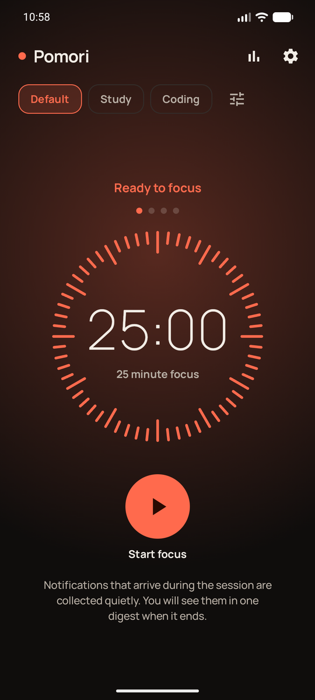
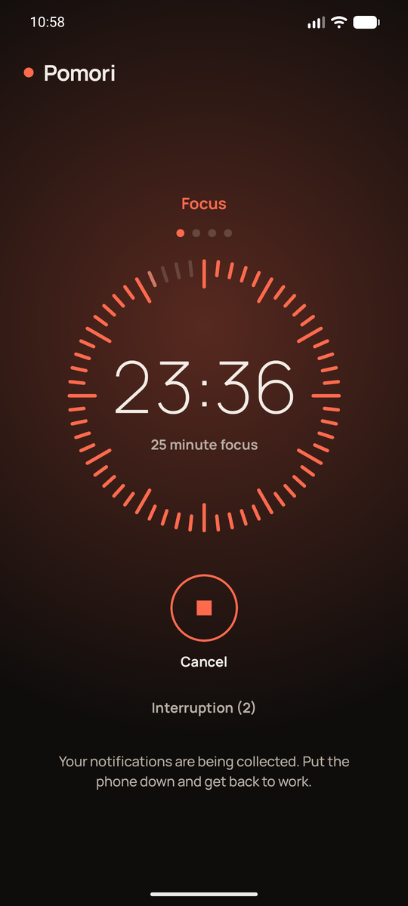
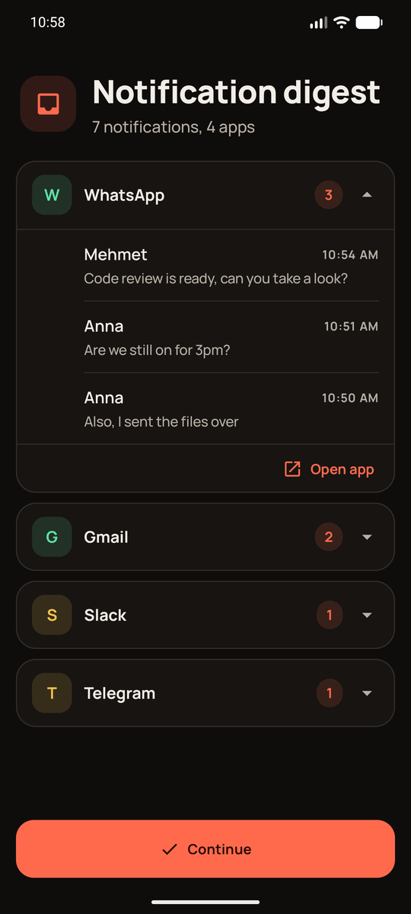
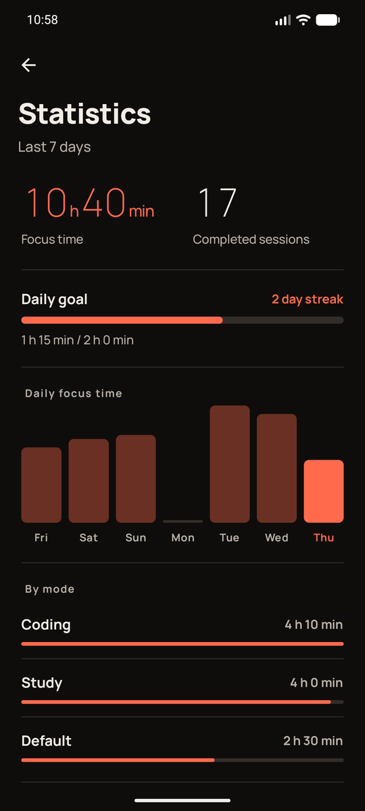

# Pomori - Pomodoro App

An Android Pomodoro timer that silently captures notifications during a focus session and, when your break starts, shows what you missed as a digest grouped by app.

> Status: in development. Roadmap: [docs/roadmap.md](docs/roadmap.md) (in Turkish)

## Problem and solution
Every notification that lands while you are trying to focus breaks your attention, but turning notifications off completely creates the worry of missing something important. Pomori captures incoming notifications quietly during a focus session and removes them from the shade, so you can keep working. When the break starts, everything you missed appears in a single digest grouped by app. Apps that must always get through can be added to an exception list so their notifications are never blocked.

## Features
- Focus and break timer with short and long breaks, driven by an end timestamp so it survives process death; an exact alarm fires the "session over" notification on time even while the phone is locked
- Duration presets (modes) with their own focus, break and long-break lengths
- Notification digest grouped by app, with notifications restored to the shade after the session (optional)
- Exception list by app or sender
- Interruption counter: tap "Interruption" during a focus session to log a distraction; the timer keeps running
- Daily focus goal with a streak counter
- Statistics: weekly focus time, completed sessions, daily chart, focus time per mode, top distracting apps
- English and Turkish UI with an in-app language setting; light, dark or system theme
- Portrait and landscape layouts

## Screenshots
<p>
  
  
  
  
</p>

## Architecture
Layered structure: **ui → domain ← data**, with Android-specific code in the `platform` package. Details: [docs/architecture.md](docs/architecture.md) (in Turkish)

## Key design decisions
- Timer design (end-timestamp based, not a decrementing counter)
- Notification access and the permission experience
- Testability (a pure Kotlin domain layer)

## Known limitations and privacy
- Notification data stays on the device and is never sent over the network (the app has no internet permission).
- Captured notifications are removed from the system, so the digest cannot jump straight back to the original conversation.
- Because notification access is a sensitive permission, the app is distributed as an APK on GitHub Releases.

## Installation
1. Download the latest `pomori-vX.Y.apk` from the [Releases](https://github.com/omerakpul/pomori/releases) page (the `debug-latest` pre-release is unsigned and meant for testing only).
2. Open the APK on your phone; if asked, allow installing from unknown sources for your browser or file manager.
3. On first launch the app asks for notification access: turn Pomori on under Settings > Notification access. Without it the app still works, but the digest stays empty.

Requirements: Android 8.0 (API 26) or newer.

### Building a signed release from source
The repository contains no signing key. With your own key:

```
keytool -genkeypair -keystore pomori-release.jks -alias pomori -keyalg RSA -keysize 2048 -validity 10000
```

Add a `keystore.properties` file in the project root (ignored by git):

```
storeFile=pomori-release.jks
storePassword=...
keyAlias=pomori
keyPassword=...
```

Then `./gradlew assembleRelease` writes the signed APK to `app/build/outputs/apk/release/`. Without the file, the release build comes out unsigned. In CI the same values are passed as the environment variables `POMORI_KEYSTORE_FILE`, `POMORI_KEYSTORE_PASSWORD`, `POMORI_KEY_ALIAS` and `POMORI_KEY_PASSWORD`.

## Tests
```
./gradlew test
```

## Tech stack
Kotlin, Jetpack Compose (Material 3), Hilt, Room, DataStore, Coroutines/Flow, WorkManager, NotificationListenerService, Foreground Service.
